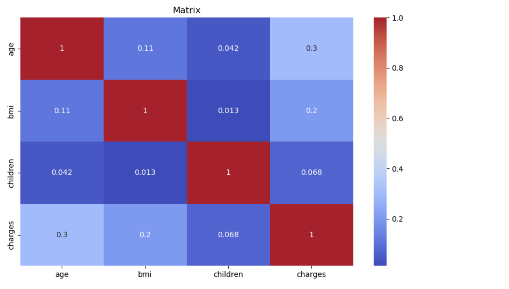
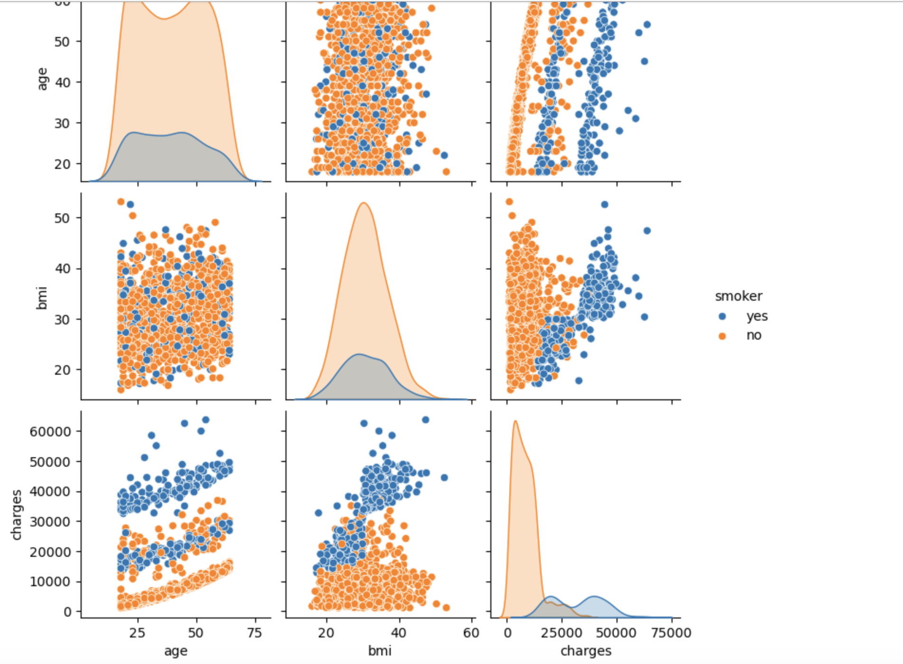

# 🏥 Medical Insurance Cost Analysis (Python Project)

## 📌 Project Overview

This project is an exploratory data analysis (EDA) of medical insurance charges using Python in a Jupyter Notebook. It looks at how personal factors such as age, BMI, number of children, smoking status, and region relate to the charges billed by a health insurer.

The dataset covers 1,338 insured individuals across four U.S. regions. The analysis uses summary statistics, a correlation heatmap, a pair plot split by smoking status, and group averages to find the factors most associated with higher charges.

## 🎯 Key Features

✅ Data Loading and Inspection: Loaded the CSV into a pandas DataFrame and reviewed its structure. 
✅ Summary Statistics: Mean, spread, and quartiles for age, BMI, children, and charges. 
✅ Categorical Breakdown: Counts and proportions for sex, smoker status, and region. 
✅ Correlation Heatmap: Shows how strongly the numeric variables move together. 
✅ Pair Plot by Smoking Status: Compares age, BMI, and charges for smokers and non-smokers. 
✅ Group Comparisons: Average charges by smoking status and by region.

## 📷 Visualizations

### Correlation Matrix

### Age, BMI, and Charges by Smoking Status

## 🗂️ Repository Files

| File | Description |
|------|-------------|
| `insurance.csv` | Raw dataset: 1,338 rows and 7 columns (age, sex, bmi, children, smoker, region, charges) |
| `health_insurance_analysis.ipynb` | Jupyter Notebook with the full analysis, code, and outputs |
| `correlation_heatmap.png` | Correlation matrix of the numeric variables |
| `smoker_pairplot.png` | Pair plot of age, BMI, and charges split by smoker status |

## 🧹 Data Preparation

- Loaded the data with `pd.read_csv()` using a relative file path, so the notebook runs from any computer.
- Checked shape and data types: 4 numeric columns and 3 text (categorical) columns.
- Confirmed the dataset has no missing values.
- Used `select_dtypes()` to split numeric columns (for correlation) from categorical columns (for counts).

## 🛠️ Skills & Tools Applied

- Language and Environment: Python, Jupyter Notebook (Anaconda)
- Libraries: pandas, NumPy, Matplotlib, Seaborn
- pandas Methods: `read_csv`, `describe`, `value_counts`, `select_dtypes`, `groupby`, `corr`
- Visualization: Correlation heatmap, pair plot with a category split (`hue`)
- Data Storytelling: Turning summary tables and charts into clear findings

## 📈 Business Questions Answered

This analysis provides insights into:

- What a typical insured person in the dataset looks like (age, BMI, family size).
- Which numeric factors are most linked to higher insurance charges.
- How much more smokers are charged on average than non-smokers.
- Whether average charges differ by U.S. region.

## 💡 Key Insights

- The average charge was **$13,270**, but the median was only **$9,382**. A small group of very high charges (up to $63,770) pulls the average up.
- **Smoking** had the largest effect. Smokers averaged **$32,050** in charges, about **3.8 times** the $8,434 average for non-smokers.
- About **20%** of the people in the dataset were smokers (274 of 1,338).
- **Age** had the strongest correlation with charges among the numeric variables (r = 0.30), followed by **BMI** (r = 0.20). The number of children had almost no relationship (r = 0.07).
- The pair plot shows that smokers with a higher BMI make up most of the highest charges, often above $35,000.
- For non-smokers, charges rise steadily with age.
- The **Southeast** had the highest average charges ($14,735). The Southwest had the lowest ($12,347).
- The sample was evenly split by sex (676 male, 662 female), and the average age was 39.

*Note: These are correlations, not proof of cause. Smoking status is a text column, so it does not appear in the correlation matrix. Its effect is shown in the pair plot and the group averages instead.*

## 🚀 Learning Outcomes

Building this project strengthened my skills in:

📌 Loading and exploring a dataset with pandas 
📌 Writing portable file paths so a notebook runs on any machine 
📌 Reading summary statistics and spotting skewed data 
📌 Building and interpreting heatmaps and pair plots with Seaborn 
📌 Comparing groups with `groupby` to answer business questions

## 🔮 Next Steps

- Build a linear regression model to predict charges from age, BMI, and smoking status.
- Encode the categorical columns so smoking status can join the correlation analysis.
- Add bar charts for average charges by region and smoker status.

## 📚 Dataset Source

[Medical Cost Personal Datasets](https://www.kaggle.com/datasets/mirichoi0218/insurance) by Miri Choi on Kaggle.

## 🙌 Acknowledgment

This project helped me build a full Python analysis workflow, from loading raw data to sharing findings. It shows how a few simple charts can explain what drives healthcare costs.

## 👨‍💻 Author

**Omar Shazley**: Data Analyst | Python, Excel, SQL, and healthcare data analytics

💼 [LinkedIn](https://www.linkedin.com/in/omar-shazley-914a16b1/) 
📧 Email: [omarshazley@gmail.com](mailto:omarshazley@gmail.com)

✨ If you like this project, don't forget to ⭐ star the repo!
